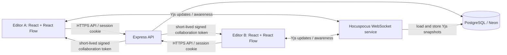

# CanvasLab Collaboration System Design

## Purpose and scope

CanvasLab is a collaborative **spatial whiteboard**, not a rich-text document editor. Google Docs system-design principles still apply to the collaboration layer—convergence, low-latency updates, durable state, access control, presence, and recovery—but CanvasLab's data model is a collection of canvas nodes and drawings.

This document distinguishes implemented behavior from guarantees that still need work. It is intentionally honest about what the current architecture does and does not provide.

## Current architecture

### Edit and sync flow

1. The client opens a Yjs `Doc` for the board and joins the Hocuspocus WebSocket room named by the board ID.
2. The server validates a short-lived signed token and checks that the user is a board member. Viewers receive a read-only connection.
3. Canvas nodes are represented in a shared Yjs map. Editable text is represented by `Y.Text`; position and other node properties are shared map values.
4. Yjs merges concurrent updates and the provider broadcasts document changes to other connected clients. Awareness carries ephemeral user presence and cursor positions.
5. Hocuspocus's database extension loads and stores the serialized Yjs document snapshot in PostgreSQL.

### Authorization refresh added in this change

- The browser asks the authenticated API for a fresh collaboration token every 60 seconds during an active board session.
- Hocuspocus re-verifies that token and re-queries current board membership on token sync.
- A removed member is rejected; a member changed to Viewer is switched to read-only.
- This bounds stale role permissions to the next refresh under normal connectivity. It is not instantaneous revocation if the client is disconnected or unable to refresh; the next connection must authenticate again.

## Design principles mapped to the implementation

| Principle | Current implementation | Status / limitation |
| --- | --- | --- |
| Concurrent edits converge | Yjs CRDT document; node map and `Y.Text` | Implemented at the data-model level; UI-level concurrent-edit scenarios still need end-to-end testing. |
| Low-latency collaboration | Hocuspocus over WebSocket; local React state updates | Implemented for connected sessions; no measured latency SLO yet. |
| Presence and cursors | Hocuspocus awareness | Implemented; presence is ephemeral and is not persisted. |
| Authentication and board ACL | Session-backed API, short-lived signed token, membership lookup, Viewer read-only mode | Implemented; active-session role refresh is now added. |
| Durable document state | PostgreSQL `board_documents.snapshot` via Hocuspocus database extension | Snapshot persistence exists, but it is debounced. Do not claim zero data loss on abrupt process failure. |
| Operation log and replay | Not present | Gap: current storage is a serialized snapshot, not a durable append-only operation log. |
| Version history and restore | Collaboration activity/history UI has partial supporting records, but no complete Yjs revision replay/restore pipeline | Gap: define immutable snapshots or operation history and test restore before claiming this feature. |
| Offline-first editing | Provider reconnect behavior only | Gap: no verified durable IndexedDB outbox/replay workflow; offline edits are not guaranteed to survive reload or merge safely. |
| Sharing and roles | Owner/editor/viewer roles, expiring invitation links, hashed invitation tokens | Implemented for API operations; permission revocation across an already-open socket is refreshed periodically. |
| Scale-out | One collaboration service and PostgreSQL persistence | Suitable for a small portfolio deployment; no multi-instance document routing/pub-sub or load test yet. |
| Reliability observability | API health endpoint and connection status UI | Partial: add collaboration health checks, structured error/latency metrics, and recovery tests. |

## Important trade-offs

- **Yjs CRDT instead of implementing OT:** Yjs is already integrated and handles concurrent updates without building a custom operational-transformation engine. CanvasLab should not claim to use Google Docs' internal algorithm; the goal is equivalent collaboration properties using a different approach.
- **Snapshot persistence instead of operation log:** simpler for the current scale, but weaker for granular history, replay, and recovery guarantees. The next storage milestone should add periodic checkpoints plus durable update history, with an explicit retention and compaction policy.
- **Single collaboration service for now:** avoids distributed routing complexity at this scale. If usage grows, route all sessions for a board consistently and introduce shared pub/sub or a supported Hocuspocus scaling adapter before adding instances.
- **Presence is separate, ephemeral data:** cursor movement should not be persisted as document edits.

## Recommended next steps

### Phase 1 — Reliability and correctness
1. Add automated API/WebSocket integration tests for editor/editor concurrent changes, editor/viewer permissions, invitation acceptance, reconnect, and save/reload.
2. Verify that a board survives collaboration-service restart and that the UI never reports “synced” before Hocuspocus confirms sync.
3. Add explicit dirty/saving/saved/error states and test persistence failures.
4. Add a production health check for the collaboration service and structured logs for authentication, sync, and snapshot-store failures.

### Phase 2 — Complete editor
1. Implement undo/redo with collaboration-aware behavior.
2. Add persistent connectors and robust multi-select/group operations.
3. Add PNG/PDF export and image support, with tests for large boards.

### Phase 3 — Collaboration depth
1. Add durable version checkpoints and restore.
2. Add an offline persistence/reconciliation design using IndexedDB and Yjs state updates.
3. Add comments anchored to canvas elements, reliable notifications, and access-control audit coverage.

### Phase 4 — Differentiation
1. Add text-to-flowchart and mind-map generation.
2. Add board summaries and brainstorming assistance only after reliability, permissions, and recovery are proven.

## Validation checklist for a release

- [ ] Two editors make concurrent edits and both clients converge after updates are exchanged.
- [ ] Viewer cannot mutate shared document state.
- [ ] Removing a member or changing their role is enforced on token refresh and on reconnect.
- [ ] Refresh/reconnect restores the latest persisted board.
- [ ] A collaboration-service restart is tested; any possible snapshot debounce loss is understood and documented.
- [ ] Offline reload behavior is explicitly tested and not advertised as safe until it passes.
- [ ] CI runs client build, client tests, server build, and server tests successfully.
